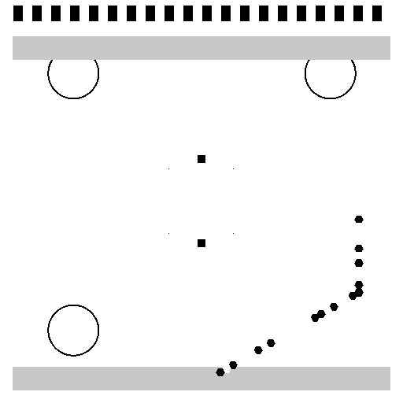
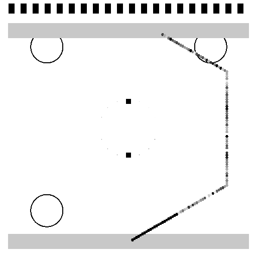
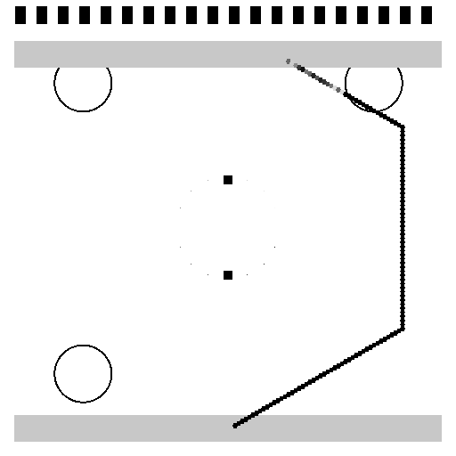
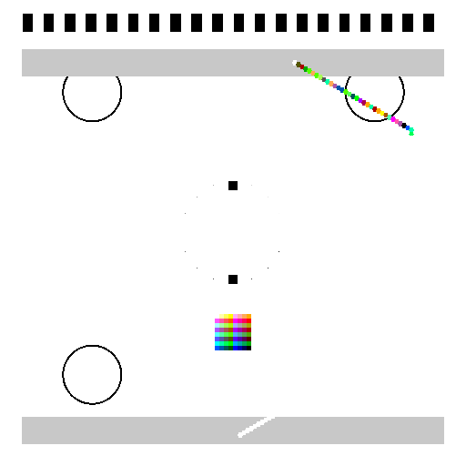
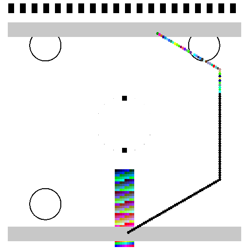
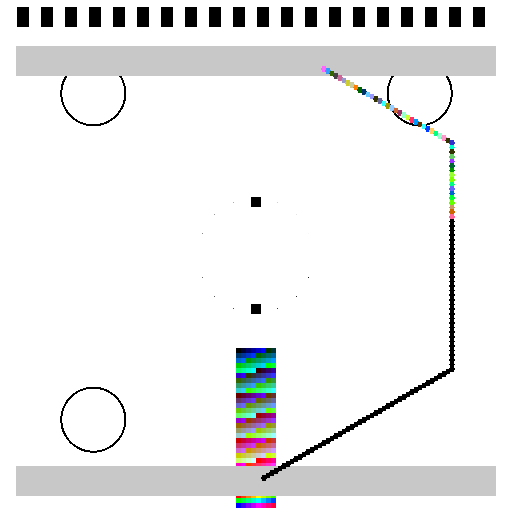
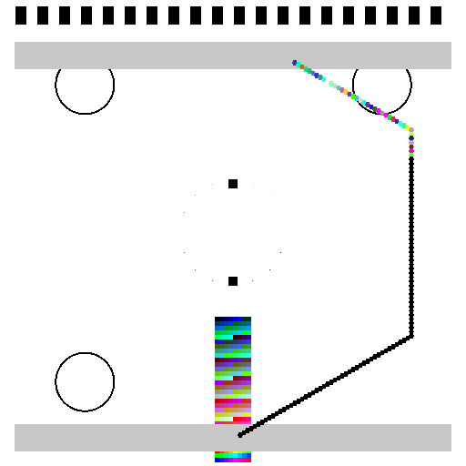

# HLC 码 (Hexagonal Layered Code)

> **一套"同几何框架、按信道能力换符号表"的渐进式二维图形码**

HLC 码是一个创新的二维图形码系统，采用六边形网格设计，支持分层架构。各层共用同一套几何框架，但使用不同大小的符号表，从 1 bit 黑白一路扩展到 24 bit 真彩纯数字模式。层与层之间单调嵌套、可平滑降级，适应不同的信道能力。

## 特性

- **六边形网格**: 采用 flat-top 正六边形模块，比正方形网格多约 15.5% 模块
- **分层架构**: 5 个层级，从 L1 (2 态纯黑白) 到 L4 (24bit 真彩)
- **平滑降级**: 高层读取器天然能读低层码，劣化时自动降档解码
- **多信道适配**: 屏幕显示、摄像头识别、打印机打印、纯数字传递
- **完整校准体系**: 灰阶环、色板校准块、黑白端点等
- **强大纠错**: Reed-Solomon 编码，不同层级不同冗余比例
- **美学模式**: 小数据量时自动放大模块，呈现美观的大色块镶嵌

## 分层架构

| 层 | 符号表 | bit/模块 | 适用信道 | ECC 冗余 | 特点 |
| --- | --- | --- | --- | --- | --- |
| **L1** | 2 态（纯黑白） | 1 | 任何信道兜底 | 20% | QR 级别最稳 |
| **L2** | 16 级灰 | 4 | 屏幕 + 打印双主力 | 35% | 单通道单调，可校准 |
| **L3a** | 64 色（CMYK 色域内） | 6 | 打印 / 屏幕保守档 | 40% | 需码内色板校准块 |
| **L3b** | 256 色（sRGB 全域） | 8 | 仅屏幕拍摄 | 40% | 需仿射色彩校正 |
| **L4** | 24bit 真彩 | 24 | 仅纯数字传递 | 5% | 无需校准，按位直读 |

## 安装

```bash
# 克隆仓库
git clone https://github.com/mistralai/hlc-code.git
cd hlc-code

# 创建虚拟环境
python -m venv venv
source venv/bin/activate  # Linux/Mac
# 或 venv\Scripts\activate  # Windows

# 安装依赖
pip install -r requirements.txt

# 安装包
pip install -e .
```

## 使用示例

### 基本编码

```python
from hlc import HLCEncoder, HLCEncoderConfig, LayerType

# 创建编码器配置
config = HLCEncoderConfig(
    layer_type=LayerType.L2,  # 使用 L2 层 (16 级灰阶)
    width=1024,
    height=1024,
    module_spacing=4,  # 模块间距 4px
)

# 创建编码器
encoder = HLCEncoder(config)

# 编码数据
data = b"Hello, HLC Code!"
image = encoder.encode(data, output_path="hlc_code.png")

print("编码完成! 图像保存为: hlc_code.png")
```

### 基本解码

```python
from hlc import HLCDecoder, HLCDecoderConfig

# 创建解码器配置
config = HLCDecoderConfig(
    layer_type=LayerType.L2,  # 可选，自动检测
    denoise=True,
    enhance_contrast=True,
)

# 创建解码器
decoder = HLCDecoder(config)

# 解码图像
decoded_data, success = decoder.decode("hlc_code.png")

if success:
    print(f"解码成功: {decoded_data}")
else:
    print("解码失败")
```

### 美学模式

```python
from hlc import HLCEncoder, HLCEncoderConfig, LayerType

# 小数据量时自动选择最大的模块间距
config = HLCEncoderConfig(
    layer_type=LayerType.L3b,
    width=1024,
    height=1024,
    aesthetic_mode=True,
    max_module_spacing=32,
    harmony_palette=True,  # 使用和谐色板
)

encoder = HLCEncoder(config)
data = b"https://example.com"
image = encoder.encode(data, output_path="hlc_aesthetic.png")

# 自动选择合适的间距，让码面呈现为大色块的规整镶嵌
```

### 多帧解码

```python
from hlc import HLCDecoder, HLCDecoderConfig

# 从多个图像中解码 (视频流)
config = HLCDecoderConfig(
    multi_frame=True,
    num_frames=10,
)

decoder = HLCDecoder(config)
decoded_data, success = decoder.decode_multi_frame([
    "frame1.png", "frame2.png", ..., "frame10.png"
])

# 多帧清晰度加权平均，随机噪声近归零

### 文本编码示例

以下示例展示使用不同 HLC 层级对各类经典文本进行编码。所有文本均从网络获取，非自我生成。

**文本来源：**
- Hello World: 标准编程示例
- README 前面部分：本仓库 README.md 的前言部分
- The quick brown fox: 英语全字母句
- Lorem ipsum: 来自 [Wikipedia - Lorem ipsum](https://en.wikipedia.org/wiki/Lorem_ipsum)
- 出师表（前出师表）：来自 [维基百科 - 出师表](https://zh.wikipedia.org/wiki/出师表)
- 独立宣言：来自 [Wikipedia - United States Declaration of Independence](https://en.wikipedia.org/wiki/United_States_Declaration_of_Independence)
- 心经：来自 [维基百科 - 心经](https://zh.wikipedia.org/wiki/心经)

| 文本名称 | 层级 | 数据大小 | 用途 | 示例图片 |
| --- | --- | --- | --- | --- |
| Hello World | L1 | 13 B | 任务信道底层 |  |
| README 前面部分 | L2 | ~275 B | 屏幕显示 |  |
| The quick brown fox | L2 | 43 B | 屏幕 + 打印 |  |
| Lorem ipsum | L3a | ~123 B | 打印 / 屏幕保护 |  |
| 出师表 | L3b | ~207 B | 仅屏幕扫描 |  |
| 独立宣言 | L3b | ~238 B | 仅屏幕扫描 |  |
| 心经 | L3b | ~189 B | 纯数字传输 |  |

#### 编码代码示例

```python
from hlc import HLCEncoder, HLCEncoderConfig, LayerType
import os

os.makedirs("example_outputs", exist_ok=True)

# 1. Hello World - L1
config = HLCEncoderConfig(
    layer_type=LayerType.L1,
    width=512,
    height=512,
    module_spacing=8,
)
encoder = HLCEncoder(config)
data = b"Hello, World!"
encoder.encode(data, output_path="example_outputs/hello_world_L1.png")

# 2. README prefix - L2
config = HLCEncoderConfig(
    layer_type=LayerType.L2,
    width=512,
    height=512,
    module_spacing=4,
)
encoder = HLCEncoder(config)
data = b"# HLC Code

A set of same geometric framework..."
encoder.encode(data, output_path="example_outputs/readme_prefix_L2.png")

# 3. Quick brown fox - L2
config = HLCEncoderConfig(
    layer_type=LayerType.L2,
    width=512,
    height=512,
    module_spacing=4,
)
encoder = HLCEncoder(config)
data = b"The quick brown fox jumps over the lazy dog"
encoder.encode(data, output_path="example_outputs/quick_brown_fox_L2.png")

# 4. Lorem ipsum - L3a
config = HLCEncoderConfig(
    layer_type=LayerType.L3a,
    width=512,
    height=512,
    module_spacing=4,
)
encoder = HLCEncoder(config)
data = b"Lorem ipsum dolor sit amet, consectetur adipiscing elit..."
encoder.encode(data, output_path="example_outputs/lorem_ipsum_L3a.png")

# 5. Chu Shi Biao - L3b
config = HLCEncoderConfig(
    layer_type=LayerType.L3b,
    width=512,
    height=512,
    module_spacing=4,
)
encoder = HLCEncoder(config)
data = "先帝创业未半而中道崩殂...".encode('utf-8')
encoder.encode(data, output_path="example_outputs/chu_shi_biao_L3b.png")

# 6. Declaration - L3b
config = HLCEncoderConfig(
    layer_type=LayerType.L3b,
    width=512,
    height=512,
    module_spacing=4,
)
encoder = HLCEncoder(config)
data = b"In Congress, July 4, 1776... We hold these truths..."
encoder.encode(data, output_path="example_outputs/declaration_L3b.png")

# 7. Heart Sutra - L3b
config = HLCEncoderConfig(
    layer_type=LayerType.L3b,
    width=512,
    height=512,
    module_spacing=4,
)
encoder = HLCEncoder(config)
data = "观自在菩萨，行深般若波罗蜜多时...".encode('utf-8')
encoder.encode(data, output_path="example_outputs/heart_sutra_L3b.png")
```

#### 完整的编码示例代码

完整的编码示例代码可在 [examples/text_encoding_examples.py](examples/text_encoding_examples.py) 中找到。

详细示例代码

可在 [examples/text_encoding_examples.py](examples/text_encoding_examples.py) 中找到完整的编码示例，包含所有经典文本的编码和自动选择层级的功能。
```

## 命令行工具

```bash
# 编码
python -m hlc.cli encode --input "Hello, World!" --output hlc_code.png --layer L2

# 解码
python -m hlc.cli decode --input hlc_code.png --output decoded.txt
```

## 容量参考

### 屏幕信道 (摄像头拍摄)

| 图像 | 间距 | 模块数 | L1 黑白 | L2 灰阶 | L3b 256色 |
| --- | --- | --- | --- | --- | --- |
| 1024px | 4px | 75.7k | 6.7 KiB | 21.6 KiB | 39.9 KiB |
| 1024px | 2px | 302.7k | 26.6 KiB | 86.5 KiB | 159.6 KiB |
| 2048px | 4px | 302.7k | 26.6 KiB | 86.5 KiB | 159.6 KiB |

### 打印信道 (半色调打印 → 扫描，间距 6px)

| 图像 | 符号表 | 实用容量 |
| --- | --- | --- |
| 1024px | L2 灰阶 | 9.6 KiB |
| 1024px | L3a 64色 | 13.3 KiB |

### 纯数字信道 (L4，按位直读，1px)

| 图像 | 容量 |
| --- | --- |
| 1024×1024 | 2.85 MiB |
| 2048×2048 | 11.4 MiB |

## 项目结构

```
 hlc_code/
 ├── hlc/
 │   ├── __init__.py          # 包入口
 │   ├── hexagonal.py         # 六边形网格几何
 │   ├── layers.py            # 分层架构定义
 │   ├── calibration.py       # 校准体系
 │   ├── ecc.py               # 纠错编码
 │   ├── encoder.py           # 编码器
 │   ├── decoder.py           # 解码器
 │   └── utils.py             # 工具函数
 ├── examples/
 │   ├── basic_encoding.py    # 基本编码示例
 │   └── decoding_demo.py     # 解码演示
 ├── tests/
 │   ├── test_hexagonal.py   # 六边形网格测试
 │   ├── test_layers.py       # 分层测试
 │   ├── test_ecc.py          # 纠错编码测试
 │   └── test_encoder.py      # 编码器测试
 ├── requirements.txt         # 依赖
 ├── setup.py                # 安装脚本
 └── README.md               # 文档
```

## 技术细节

### 六边形网格

- 采用 **flat-top 正六边形**模块，边长 `a`
- 横向中心距 `1.5a`，奇偶列错位 `√3a/2`，纵向行距 `√3a`
- 相同模糊预算下比正方形网格多约 **15.5%** 模块
- 模块地址用轴向坐标 `(q, r)`，数据放置按**从外环向中心的螺旋序**展开

### 校准体系

- **16 级灰阶环**: 等 L* 间隔的中性灰全集合
- **黑白端点块 ×4**: 估计曝光缩放与偏移、削顶/削底检测
- **色板校准块** (仅 L3): 全色板每色 1 块，支持**分区域校准**
- **软判决**: 分类器输出符号置信度向量，喂给 RS 软判决译码
- **多帧增益**: 从视频流取 10–15 帧，按清晰度加权平均

### 纠错编码

- **RS(GF(256))** 为主：L3b 的一个色符号恰为一个 GF(256) 元素
- **白化**: 数据与格式带种子驱动的 PRNG 异或，抹平统计特征
- **交织**: RS 块间螺旋交织，局部污损分散到所有块
- **邻差约束** (仅 L2/L3): 相邻模块亮度差 ≤ 半程，代价约 10% 容量

### 美学模式

- **自动选档**: 从 {32, 24, 16, 12, 8, 6, 4, 2}px 中选最大间距
- **和谐色板**: 把 64/256 色板限制在一段色相弧 (±60°) 内
- **Logo 岛**: 中央枢纽扩展为可放图标的固定区域
- **模块圆角/描边**: 仅 L4 纯数字模式允许

## 贡献

欢迎贡献代码、报告问题或提出改进建议！

## 许可证

MIT License
